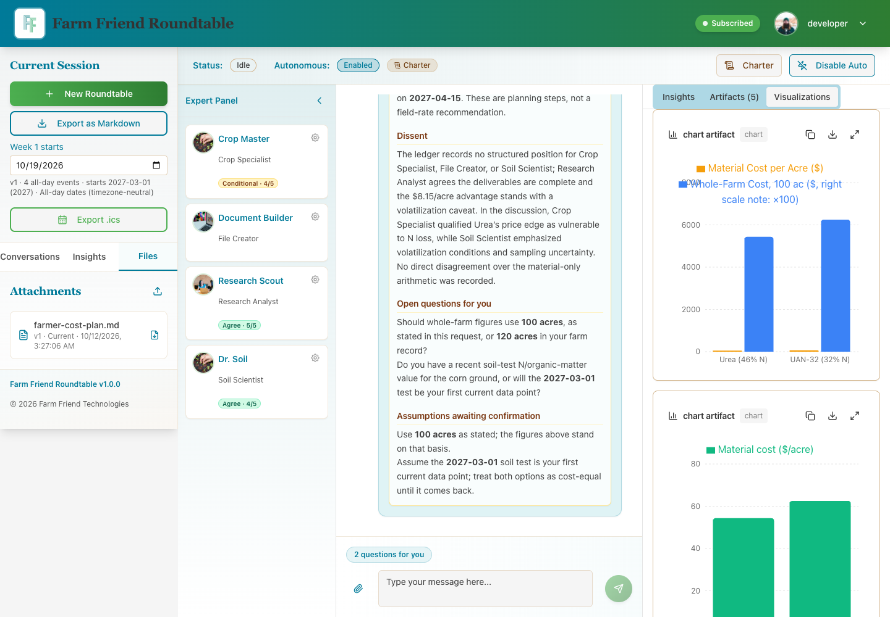
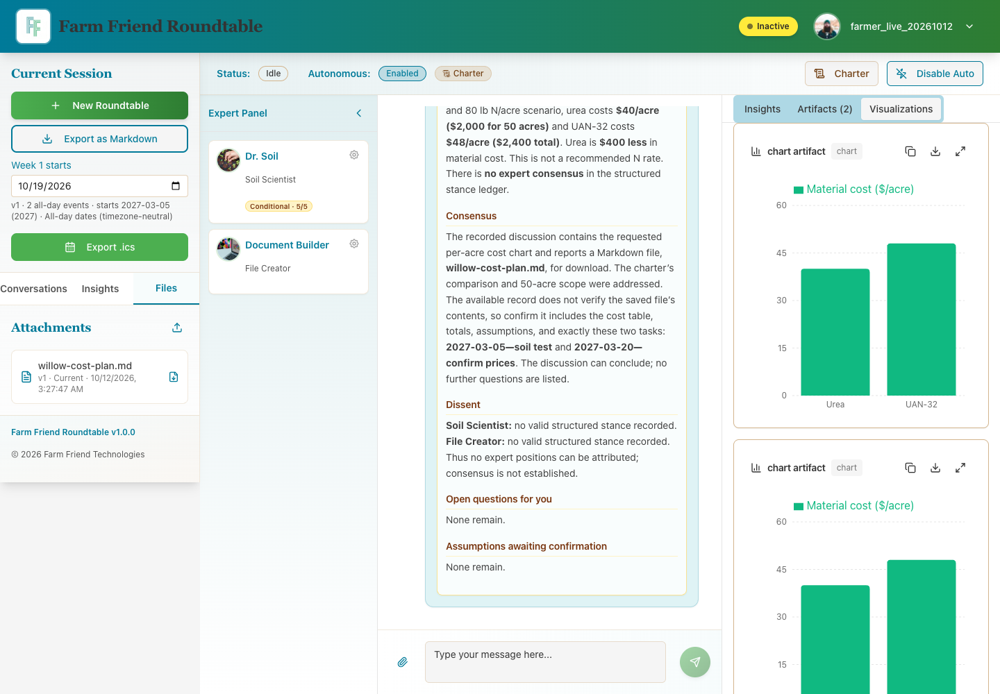
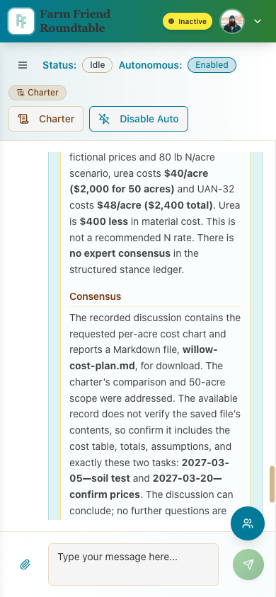
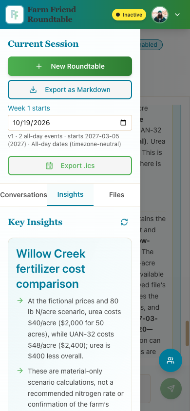

# Provider recovery and farmer-flow verification — 2026-10-12

The local app is usable: specialist replies, generated Markdown plans, bar charts, and calendar downloads were verified for two separate users. The existing OpenRouter credential works; no credential replacement was needed. GPT-6 Luna with max reasoning performed the provider diagnosis through Herdr.

## Findings and surgical fixes

- **Specialist truncation:** the verification spend cap forced `max_tokens=1024`. A live GLM request returned HTTP 200 but `finish_reason=length` at exactly 1,024 completion tokens. The adapter rejected it with its output-limit error. Capped requests now use the normal 8,192-token allowance; dollar reservations and computed provider price limits remain active.
- **File Creator veto:** “save a downloadable Markdown plan” did not qualify as a generation request. The moderator repeatedly selected File Creator, but the orchestrator blocked it. Added `save`/`saving` to the existing intent checks, including cancellation handling. Regression tests failed before the fix and passed afterward.
- **Restart recovery:** a paused conversation restored with `lastUserMessage=null`, dropping the file request. Recovery now restores farmer context and the exact active request ID saved in the JSONB snapshot, preventing older discussions from being revived. Regression cases cover corrections, cancellation, retrieval-only requests, old file requests, and explicit topic restarts. The first farmer correction after server restart also preserves the saved request before initialization overwrites the snapshot.
- **Obsolete free defaults:** four exact free model IDs were absent from the live catalog. Updated affected selector and Quick Test defaults to `nvidia/nemotron-3-super-120b-a12b:free`, which passed a live provider call.
- **Calendar refresh:** the preview stayed empty after a generated file arrived. Refresh it when the conversation's files change.
- **Development socket:** Vite HMR collided with the local app WebSocket server. Locally it now uses its normal separate port, 24678; hosted Replit development retains the app server socket. A fresh local browser session logs `[vite] connected.` and has no page errors.
- **Mobile sidebar:** added a white background beneath the existing gradient so the open drawer is readable over chat.

## Live evidence

All four saved models passed both direct chat and streaming calls: `openai/gpt-6-luna`, `deepseek/deepseek-v4.1-flash`, `xiaomi/mimo-v2.6-flash`, and `z-ai/glm-5.3-flash`. All eight short calls ended normally. The replacement NVIDIA free model also answered normally.

| User / conversation | Verified deliverable | Verified calculations | Calendar |
|---|---|---|---|
| `developer` / 10 | `farmer-cost-plan.md`, file 8, current version 1 | Fictional 100-acre scenario: urea $54.35/ac and $5,434.78 total; UAN-32 $62.50/ac and $6,250 total | Four events on 2027-03-01, 2027-03-15, 2027-04-01, 2027-04-15 |
| `farmer_live_20261012` / 11 | `willow-cost-plan.md`, file 9, current version 1 | Fictional 50-acre scenario: urea $40/ac and $2,000 total; UAN-32 $48/ac and $2,400 total | Two events on 2027-03-05 and 2027-03-20 |

Both generated file downloads and calendar responses returned HTTP 200. Clicked the second user's download and calendar export controls. Both conversations ended idle and retained files and charts after server restart. Cross-account file downloads returned 404 in both directions; the second user also received 404 for the first user's conversation, messages, and file listing. The new local QA account received a Pro-tier fixture override to test paid models; no subscription purchase occurred.

The resumed Luna worker also verified a fresh conversation 12: revision request 67 was saved in its paused snapshot before app restart. Clicking Resume without another farmer message produced current version 2 (file 11), superseded version 1 (file 10), and returned the conversation to idle. The authenticated version-2 download returned HTTP 200 and contained the requested title, “Restart Resume Verified.” See [live recovery retest](recovery-retest.md) for screenshots and detailed evidence.

The realistic post-fix run succeeded with a $1.50 process spend cap. Known app-provider spend across the two browser processes was $0.03701733. The worker's short calls cost $0.00005984 and its capped truncation reproduction cost $0.00005374. An additional 3,000-word probe hit the existing 120-second timeout without usage telemetry; it reserved $0.05. Long-output timeout behavior is still bounded at 120 seconds.

## Browser and automated checks

Environment: `http://localhost:5001`, local PostgreSQL, Chromium through the installed agent-browser skill. The Browser plugin was unavailable. Desktop 1440×1000; mobile 390×844.

| Check | Result |
|---|---|
| Page identity / meaningful content / no framework overlay | Pass |
| Fresh browser page errors and Vite connection | Pass: no page errors; reload socket connected |
| Ask question → specialist replies → charts → Files → downloads | Pass for two accounts |
| Account isolation and restart persistence | Pass |
| Mobile sidebar opening, readability, and dismissal | Pass |
| Regression tests | Final Luna worker validation: 604 tests passed across 23 files; see [worker final validation](final-review.md) |
| Typecheck / production build / diff whitespace | Pass |

Commands: `npm run dev`, live provider probes through `OpenRouterProvider`, `agent-browser` navigation/snapshots/screenshots/download clicks, authenticated read-only fetches, `npm test`, `npm run check`, `npm run build`, and `git diff --check`. A single full-suite run had an intermittent auth-test 404; the auth suite then passed alone and the final full suite passed. No auth implementation was changed.

Weather remains unavailable for the existing farm coordinates because OpenWeather returns a One Call subscription 401. This did not prevent replies or deliverables. Payments, production deployment, and the accuracy of research citations were not tested. Build warnings remain for Browserslist age and bundle size; tests retain their existing MemoryStore listener warnings.

## Screenshots

